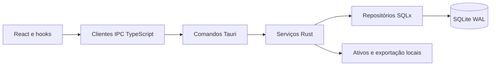

# Estado do sistema

Inspeção de código: **08/11/2026**. Versão declarada nos manifests: **0.1.0**;
isso não comprova uma release publicada. Evidência desta tarefa fica em
[TASK.md](../TASK.md); resultados históricos não substituem validação atual.

## Mapa para contribuição

| Capacidade | Implementação / entrada | Estado observado |
| --- | --- | --- |
| Biblioteca, universos e séries | `src/components/library/`, `src/hooks/`, serviços e repositórios de livros/séries/universos | Implementado; testes de domínio e navegador existentes |
| Editor, histórico e revisão | `src/components/books/`, `chapter_*`, `review_*` em Rust | Implementado; revisão esperada e restauração transacional |
| Códice e galeria | `src/lib/api/codex*`, `src-tauri/src/services/codex/` | Escopos, estrutura, modelos e ativos implementados |
| PDF/EPUB/DOCX | `src-tauri/src/services/export/` | Implementado; validação visual em leitores externos tem limites |
| Banco e migrations | `src-tauri/src/database/`, `src-tauri/migrations/` | SQLite WAL, foreign keys, SQLx migrate na inicialização |
| Prévia web | `src/lib/api/browser*`, mocks e localStorage | Facilita UI/testes; não valida SQLite, diálogos ou WebView2 |
| Sync/API remota/MySQL | Direção no documento de arquitetura | Não identificado como fluxo operacional; não exigir rede |
| Dossiê narrativo e quadro de trama | [Plano de funcionalidades](roadmap-funcionalidades.md) | Planejamento; confirmar código da tarefa antes de declarar entrega |
| Governança e CI por escopo | `.agents/`, `scripts/`, `.github/workflows/verify.yml` | Configuração local; execução remota exige envio ao GitHub |
| Entrega Windows | `.github/workflows/windows-artifact.yml` | Workflow manual de candidato; sem publicação automática |

## Dependências entre camadas

`src-tauri/src/lib.rs` registra comandos; `src/types/` e `src/lib/api/` definem
contratos frontend. Fontes em `public/fonts/`, CSS em
`src/lib/editor/bookTypography.css` e presets em
`src-tauri/resources/codex-presets.json` são compartilhados. CI considera isso,
mesmo quando a alteração aparece em apenas uma pasta.

## Dívidas observadas, sem correção funcional nesta tarefa

- **Integridade de backup:** `backup_service.rs` copia SQLite após checkpoint e
  possui erros ignorados no checkpoint/backup de emergência e contagens. O pacote
  não transporta todos os arquivos externos das imagens. Precisa de testes de
  falha, concorrência, restauração e desenho de backup completo.
- **Segurança desktop:** `src-tauri/tauri.conf.json` declara `csp: null`.
  Definir CSP compatível com fontes, ativos e IPC exige validação do runtime;
  não habilitar uma política arbitrária sem testar o editor/exportação.
- **Fronteiras e erros:** há SQL no serviço de backup e mapeamento de erros não
  uniforme, apesar da política Command → Service → Repository. Não replicar
  essas exceções em funcionalidades novas.
- **Desempenho:** expressões como “sub-millisecond” no material de apresentação
  são metas, sem benchmark reproduzível inventariado.
- **Distribuição:** assinatura de código, atualização automática, homologação
  de instalador e suporte macOS/Linux não são demonstrados pelo CI browser.
- **Documentação antiga:** cronogramas por “Dia N” são especificações históricas;
  consultar este inventário e o código para estado atual.

Prioridades propostas em [ROADMAP](ROADMAP.md). Não foram criadas issues remotas,
regras de proteção ou releases por esta alteração.
