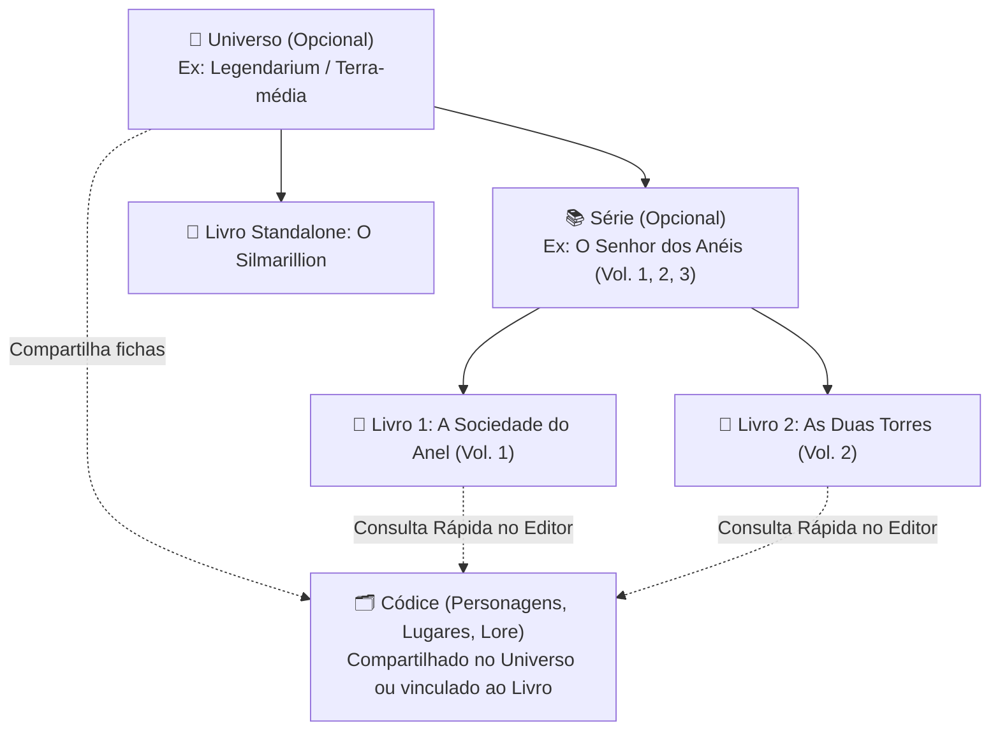

# Roadmap de Funcionalidades & Arquitetura de Expansão — My Book Writer

> **Visão de Produto**: Evoluir o *My Book Writer* de um editor e exportador de livros para um **Estúdio Editorial e de Worldbuilding Local-First**, integrando organização de obras (**Universos** e **Séries**), construção de mundo (**Códice**: Personagens, Lugares e Lore) e escrita do manuscrito de forma coesa e sem inflar a aplicação.

---

## 1. Decisões Alinhadas de Produto e Arquitetura

1. **Nomenclatura Oficial na Interface**:
   * **Universo**: Agrupador de mundo compartilhado entre livros e séries (ex: *Legendarium / Terra-média*, *Cosmere*).
   * **Série**: Agrupador sequencial de livros com numeração automática de volumes (`Vol. 1`, `Vol. 2`, `Vol. 3`...) e reordenação livre pelo autor.
   * **Códice**: Hub unificado onde vivem as fichas de **Personagens**, **Lugares** (cidades, países, reinos, locais) e **Conceitos/Itens**.
2. **Regra de Escopo e Compartilhamento do Códice**:
   * Quando um livro pertence a um **Universo** (diretamente ou por meio de uma **Série** vinculada àquele Universo), as fichas de Personagens e Lugares pertencem ao **Universo**, sendo compartilhadas automaticamente entre todos os livros daquele mundo.
   * Quando um livro é uma obra avulsa (sem Universo), suas fichas pertencem diretamente ao **Livro**. Caso o livro seja posteriormente vinculado a um Universo, suas fichas passam a integrar o Códice daquele Universo sem perda de dados.
3. **Arquitetura de Rotas do Códice**:
   * Motor único no SQLite/Rust (`codex_entities`, `codex_categories`, `codex_fields`, `codex_documents`, `codex_relations`) discriminado por tipo (`character`, `location`, `lore`).
   * Hub unificado em `/codex` com abas por categoria, página de ficha em `/codex/sheet` e editor narrativo focado com histórico de versões em `/codex/editor`.

---

## 2. Hierarquia de Domínio

---

## 3. Especificação das Fichas do Códice (Inspiração *Arc Raiders RPG Sheet*)

As fichas de **Personagens** e **Lugares** combinam estética de dossiê tático/editorial com flexibilidade total:

### 3.1. Estrutura Visual em Duas Colunas

* **Coluna Esquerda (Identidade & Galeria)**:
  * **Galeria Múltipla de Imagens**: Retrato principal + miniaturas navegáveis vinculadas à infraestrutura local `image_assets` (SHA-256).
  * **Classificação Rápida**: Papel na trama (*Protagonista*, *Antagonista*, *Secundário*, etc.), Status (*Vivo*, *Falecido*, *Desaparecido* ou customizado) e Título/Arquétipo.
  * **Tags Rápidas & Aparições**: Emblemas de traços marcantes e contagem automática de capítulos/livros onde a entidade aparece.
* **Coluna Direita (Abas de Categorias & Campos Customizáveis)**:
  * **Abas Gerenciáveis pelo Usuário**: O autor pode criar, renomear, reordenar e excluir categorias (ex: *Dados Gerais*, *Características Físicas*, *Psicologia*, *Relações*, *Sistema de Magia*).
  * **Campos Pré-estabelecidos Removíveis + Campos Livres**:
    1. **Texto Curto**: Nome de nascimento, idade, ocupação, clima, população, governo.
    2. **Texto Longo**: Resumo rápido, peculiaridades, atmosfera sensorial.
    3. **Tags / Lista**: Virtudes, defeitos, idiomas, recursos.
    4. **Barra de Atributo / Escala (0–100)**: Inspirado em fichas de RPG (ex: *Liderança*, *Diplomacia*, *Periculosidade*, *Influência*).
    5. **Vínculo com Outra Ficha**: Conecta personagens a outros personagens (*Aliado*, *Rival*, *Mentor*) ou a lugares (*Cidade Natal*, *Sede*).
    6. **Documento Narrativo Focado (`/codex/editor`)**: Abre um editor de texto rico idêntico ao editor de capítulos, **sem** barra lateral de capítulos, **sem** exportação/visualização/revisão e **sem** modo paginado, mas **com Histórico de Versões (Snapshots e Diff)**.
  * **Modelos de Ficha (Templates)**: Botão *"Salvar como Modelo"* para que o autor reutilize sua estrutura favorita de abas e campos em novos personagens ou lugares.

---

## 4. Cronograma de Implementação Diário (Vertical Slices)

Cada etapa diária entrega uma fatia funcional completa, validada por testes automatizados (`cargo test`, `vitest`, `playwright`) e respeitando o limite de 70 linhas por `.tsx`.

### Fase 1 — Organização da Biblioteca: Universos e Séries

- [x] **Dia 1 — Banco de Dados, Backend Rust e API Frontend para Universos e Séries** *(Concluído)*
  * Migration SQLite (`universes`, `book_series` e vínculo em `books` com `universe_id`, `series_id` e numeração automática `series_volume`).
  * Domínio, Repositórios SQLx, Serviços de aplicação (numeração automática `1..N`, reordenação atômica de volumes, herança de universo e limpeza segura em soft-delete) e Comandos Tauri IPC.
  * Tipos TypeScript, cliente IPC/localStorage (`src/lib/api/series.ts` e `src/lib/api/universes.ts`), recursos reativos e testes unitários/integração.
* [x] **Dia 2 — Gestão de Séries na Biblioteca (`/library`)** *(Concluído)*
  * Criação, edição de nome/descrição e exclusão de Séries na Biblioteca, inclusive antes do primeiro livro; excluir uma série preserva seus livros e capítulos.
  * Biblioteca em estilo Explorer: cards de Universos, Séries e livros avulsos misturados por padrão, com opção persistida de separar por tipo em linhas distintas, tanto em grade quanto em lista.
  * Cards de coleção usam as três primeiras capas: pilha sequencial para Séries e leque aberto para Universos. Todas as capas ficam contidas na área de imagem; posições sem livro usam preenchimento sólido semitransparente, sem contorno pontilhado. Abrir um card navega pelo conteúdo local, com caminho contextual e histórico do navegador.
  * Badge automático de volume (`Vol. 1`, `Vol. 2`...) e reordenação persistida dentro da Série por *drag-and-drop* ou botões acessíveis por teclado. Filtros preservam os volumes ocultos; a ordenação geral não altera a sequência da série.
  * Livros podem pertencer simultaneamente a uma Série e a um Universo. Arrastar um livro para um Universo preserva sua Série; entrar em uma Série sem Universo preserva o Universo direto do livro. Séries podem ser arrastadas para Universos, vinculando também seus livros sem alterar os volumes. Universos não podem ser filhos de Séries ou livros, e Séries não podem ser filhas de outras Séries ou livros.
  * As alternativas “Mover livro” e “Mover série” oferecem as mesmas ações por teclado. Voltar explicitamente um livro à raiz remove seus vínculos; tirar uma Série do Universo remove também esse vínculo de seus livros, que permanecem na Série e mantêm os volumes. A atualização nativa é atômica para Série e livros.
  * O caminho dos livros inclui seus agrupadores: `Biblioteca > Universo > Série > Livro`, seguido da seção atual quando aplicável. Os nomes de Universos e Séries são links para suas coleções.
  * Seleção, troca e remoção de Série diretamente na criação/configuração do livro, com numeração automática e detecção de alterações não salvas.
  * Arrastar e soltar HTML habilitado no Windows por `dragDropEnabled: false` no Tauri; operações continuam usando as APIs locais do Dia 1.
  * Testes de agrupamento/reordenação e fluxos Playwright: criação offline, edição, exclusão sem perda de livros, seleção/troca/remoção, filtros, persistência, falhas IPC com nova tentativa e acessibilidade nos temas claro/escuro.
* [x] **Dia 3 — Gestão de Universos na Biblioteca (`/library`)** *(Concluído)*
  * Criação, edição de nome/descrição e exclusão de Universos, inclusive vazios. A exclusão preserva séries, livros, volumes e capítulos; erros mantêm o formulário preenchido e permitem nova tentativa.
  * Associação de livros e séries por arrastar ou pelos diálogos acessíveis; séries novas podem ser criadas dentro de um Universo.
  * Filtros rápidos *Todos*, *Livros*, *Séries* e *Universos*, combinados com busca, formato, ordenação e apresentação em grade/lista. Na raiz, as visões por tipo incluem itens aninhados; dentro de um Universo ficam limitadas ao seu conteúdo. Abrir uma coleção ou limpar os filtros restaura a visão completa.
  * Botão “+” com opções *Livro*, *Série* e *Universo*, destacando Livro. O menu usa popover nativo, navegação por teclado, Escape e retorno do foco ao acionador.
  * Cadastro de livros com seleção de Universo e contexto da coleção de origem; entrar pelo menu de uma Série pré-seleciona a série e herda seu Universo, preservando a numeração automática.
  * Select compartilhado com `appearance: base-select` e `::picker(select)`, conforme o artigo do Chrome, com aprimoramento progressivo, cores semânticas e ícones locais. Busca, filtros e visualização usam a mesma linguagem de controles.
  * Regressões de edição, exclusão de Universo preenchido, criação contextual, falha IPC com nova tentativa, filtros combinados e acessibilidade dos controles nos dois temas.

### Fase 2 — O Códice: Fichas de Personagens e Lugares

- [x] **Dia 4 — Motor de Dados do Códice (SQLite + Rust + API)**
  * Migration para `codex_entities`, `codex_entity_images`, `codex_categories`, `codex_fields` e `codex_templates`.
  * Presets iniciais automáticos para *Personagem* e *Lugar*, repositórios SQLx, serviços e comandos Tauri.
  * CRUD de Personagens, Lugares e Conceitos, estrutura ordenada de categorias/campos e modelos personalizados sem copiar conteúdos das fichas.
  * Escopo por Livro/Universo e perfil, com promoção transacional das fichas ao vincular Livro ou Série a um Universo; contextos excluídos permanecem consultáveis como arquivos.
  * API TypeScript tipada, hooks/cache e prévia web local. Contratos e limites descritos em [Motor de Dados do Códice](codex-data.md). Galeria, telas e editor seguem nos próximos dias.
* [x] **Dia 5 — Hub do Códice (`/codex`) & Criação com Presets**
  * Entrada **Códice** na navegação lateral, listagem em cards com abas (*Personagens*, *Lugares*, *Conceitos*), filtro por Universo/Livro e modal de criação rápida.
  * Busca sem distinção de acentos, contadores por tipo, escopo e aba na URL com histórico e recarga; links por Livro resolvem o Universo compartilhado quando aplicável.
  * Criação por presets/modelos com validação, prevenção de envio duplicado, recuperação de falhas e resumo das categorias da ficha após criar ou abrir um card.
  * Contextos arquivados para consulta, estados de carregamento/vazio/erro, controles acessíveis por teclado e validação Chromium/Firefox nos dois temas. Detalhes em [Hub do Códice](codex-hub.md).
* [x] **Dia 6 — Ficha Visual (`/codex/sheet` — Coluna Esquerda & Galeria Múltipla)**
  * Layout inspirado no *Arc Raiders RPG Sheet*: galeria com múltiplas imagens vinculadas à ficha, seletor de foto principal, status, papel na história e tags.
  * Importação local com SHA-256, miniaturas navegáveis, legenda, principal no card do hub e remoção com confirmação; imagens também funcionam em Universos sem livros.
  * Edição de identidade com status/papel personalizados, arquétipo, resumo e tags; proteção de alterações não salvas e consulta de contextos arquivados.
  * Migração preservando capas existentes, transações e limpeza após falha; estados de erro com nova tentativa e validação Chromium/Firefox em ambos os temas. Detalhes em [Ficha visual e galeria](codex-sheet.md).
* [x] **Dia 7 — Abas Customizáveis, Campos Dinâmicos e Modelos de Ficha** *(Concluído)*
  * Coluna direita da ficha: gerenciamento de abas (categorias), adição/remoção/edição de campos (texto, escala/barra estilo RPG, tags, vínculo entre fichas) e salvamento de Modelos (*Templates*). Detalhes em [Abas customizáveis e campos dinâmicos](codex-tabs.md).

### Fase 3 — Dossiê Narrativo com Histórico de Versões

- [ ] **Dia 8 — Editor de Documento Narrativo do Códice (`/codex/editor`)**
  * Tipo de campo que redireciona para o editor focado (mesma experiência de escrita de capítulos, sem barra lateral de capítulos, exportação, visualização, revisão ou modo paginado).
* [ ] **Dia 9 — Histórico de Versões para Documentos do Códice**
  * Criação automática e manual de snapshots, visualização de diff e restauração de versões nos documentos longos de personagens e lugares.

### Fase 4 — Conexão Manuscrito ↔ Mundo & Produtividade Editorial

- [ ] **Dia 10 — Vínculo Capítulo ↔ Personagens/Lugares & Quadro de Trama**
  * Marcar POV (Ponto de Vista), personagens presentes e local da cena nos capítulos, alimentando automaticamente a seção *"Aparições no Manuscrito"* nas fichas do Códice.
* [ ] **Dia 11 — Gaveta de Consulta Rápida (*Quick Peek*) no Editor de Capítulos**
  * Painel lateral deslizante dentro do editor de capítulos para consultar qualquer ficha de Personagem ou Lugar sem interromper a escrita.
* [ ] **Dia 12 — Metas de Escrita & Linha do Tempo do Universo**
  * Metas de palavras por livro e diárias + visão cronológica de eventos do Universo.
